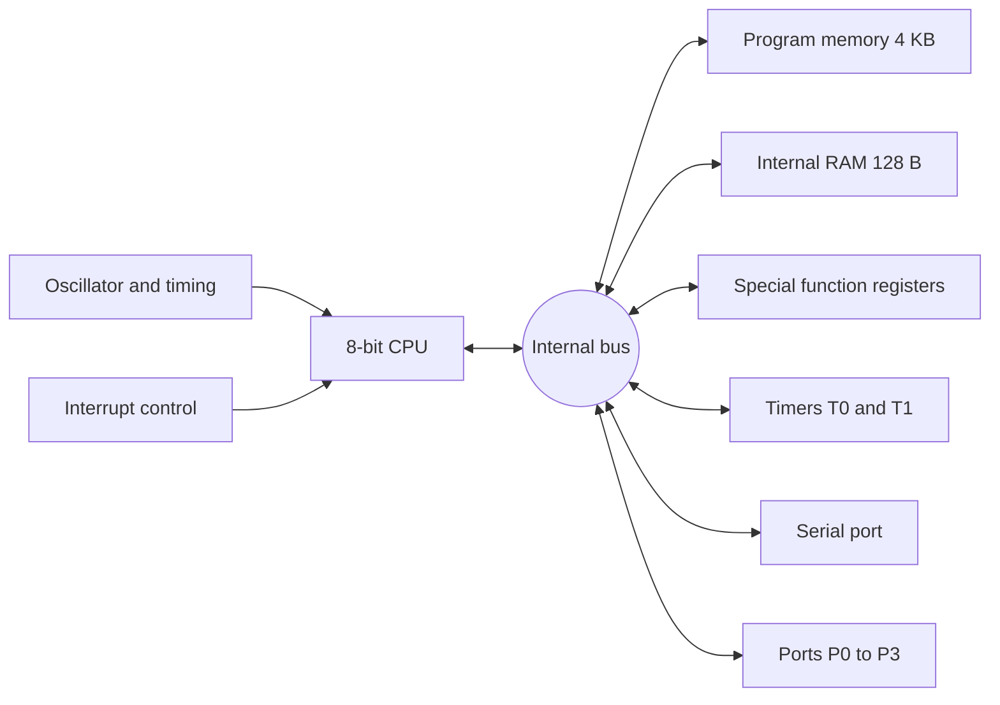

# 8051 Microcontroller Architecture

Study notes on the classic Intel 8051: its architecture, registers, memory map and on-chip peripherals.

## Contents

- [At a glance](#at-a-glance)
- [Block diagram](#block-diagram)
- [Memory organisation](#memory-organisation)
- [Registers](#registers)
- [I/O ports](#io-ports)
- [Timers](#timers)
- [Serial port](#serial-port)
- [Interrupts](#interrupts)
- [Machine cycle timing](#machine-cycle-timing)

## At a glance

| Feature | Classic 8051 |
|---|---|
| CPU | 8-bit, with a Boolean (bit) processor |
| Program memory | 4 KB on chip, 64 KB address space |
| Data memory | 128 bytes on chip, 64 KB external address space |
| I/O | 32 lines, four 8-bit ports (P0 to P3) |
| Timers | Two 16-bit (T0 and T1) |
| Serial | One full-duplex UART |
| Interrupts | 5 sources, 2 priority levels |
| Machine cycle | 12 clock periods |

Many modern 8051-compatible chips have more memory and shorter machine cycles. Check the datasheet of your part.

## Block diagram

## Memory organisation

Program memory and data memory are separate address spaces.

### Internal RAM

| Address | Use |
|---|---|
| `00H` to `1FH` | Four register banks, R0 to R7 in each |
| `20H` to `2FH` | Bit-addressable area, 128 bits (`00H` to `7FH`) |
| `30H` to `7FH` | General-purpose RAM |
| `80H` to `FFH` | Special function registers, direct addressing only |

After reset, SP is `07H`, so the first PUSH writes to `08H`. That is R0 of bank 1. Move SP higher if you use other banks.

### Register bank selection

| RS1 | RS0 | Bank | Address |
|---|---|---|---|
| 0 | 0 | 0 | `00H` to `07H` |
| 0 | 1 | 1 | `08H` to `0FH` |
| 1 | 0 | 2 | `10H` to `17H` |
| 1 | 1 | 3 | `18H` to `1FH` |

## Registers

| Register | Address | Purpose |
|---|---|---|
| ACC (A) | `E0H` | Accumulator |
| B | `F0H` | Multiply and divide |
| PSW | `D0H` | Status flags and bank select |
| SP | `81H` | Stack pointer, reset value `07H` |
| DPL, DPH | `82H`, `83H` | Data pointer DPTR, 16-bit |
| P0, P1, P2, P3 | `80H`, `90H`, `A0H`, `B0H` | I/O ports |
| PCON | `87H` | Power control, SMOD bit |
| TCON, TMOD | `88H`, `89H` | Timer control and mode |
| TL0, TL1, TH0, TH1 | `8AH`, `8BH`, `8CH`, `8DH` | Timer counts |
| SCON, SBUF | `98H`, `99H` | Serial control and buffer |
| IE, IP | `A8H`, `B8H` | Interrupt enable and priority |

The program counter (PC) is 16 bits and has no address. Registers whose address ends in 0 or 8 are bit-addressable.

### PSW bits

| 7 | 6 | 5 | 4 | 3 | 2 | 1 | 0 |
|---|---|---|---|---|---|---|---|
| CY | AC | F0 | RS1 | RS0 | OV | reserved | P |

P is 1 when A holds an odd number of 1s.

## I/O ports

| Port | Notes |
|---|---|
| P0 | Open drain, needs external pull-ups as general I/O. Multiplexed address and data (AD0 to AD7) with external memory |
| P1 | General I/O with internal pull-ups |
| P2 | General I/O. High address byte (A8 to A15) with external memory |
| P3 | General I/O with the alternate functions below |

| P3 pin | Function | P3 pin | Function |
|---|---|---|---|
| P3.0 | RXD | P3.4 | T0 |
| P3.1 | TXD | P3.5 | T1 |
| P3.2 | INT0 (active low) | P3.6 | WR (active low) |
| P3.3 | INT1 (active low) | P3.7 | RD (active low) |

Write 1 to a port pin before using it as an input.

## Timers

| Mode | M1 M0 | Operation |
|---|---|---|
| 0 | 00 | 13-bit |
| 1 | 01 | 16-bit |
| 2 | 10 | 8-bit auto-reload, reload value in THx |
| 3 | 11 | T0 splits into two 8-bit timers |

## Serial port

| Mode | SM0 SM1 | Operation | Baud rate |
|---|---|---|---|
| 0 | 00 | 8-bit shift register | f_osc / 12 |
| 1 | 01 | 8-bit UART | Variable (Timer 1) |
| 2 | 10 | 9-bit UART | f_osc / 64 or f_osc / 32 |
| 3 | 11 | 9-bit UART | Variable (Timer 1) |

With Timer 1 in mode 2: `baud = (2^SMOD / 32) x f_osc / (12 x (256 - TH1))`

At 11.0592 MHz with SMOD = 0, `TH1 = FDH` gives 9600 baud.

## Interrupts

Listed in order of polling priority within the same level.

| Source | Flag | Vector |
|---|---|---|
| External 0 | IE0 | `0003H` |
| Timer 0 | TF0 | `000BH` |
| External 1 | IE1 | `0013H` |
| Timer 1 | TF1 | `001BH` |
| Serial | RI or TI | `0023H` |

Reset starts at `0000H`. RI and TI must be cleared in software.

## Machine cycle timing

One machine cycle is 12 clock periods. At 12 MHz that is 1 microsecond; at 11.0592 MHz it is about 1.085 microseconds.

## Author

**Smrutiranjan Sahoo**, Electronics and Communication Engineering
[GitHub](https://github.com/SMRUTIRANJAN30) · [Email](mailto:smrutiranjansahoopikun@gmail.com)
